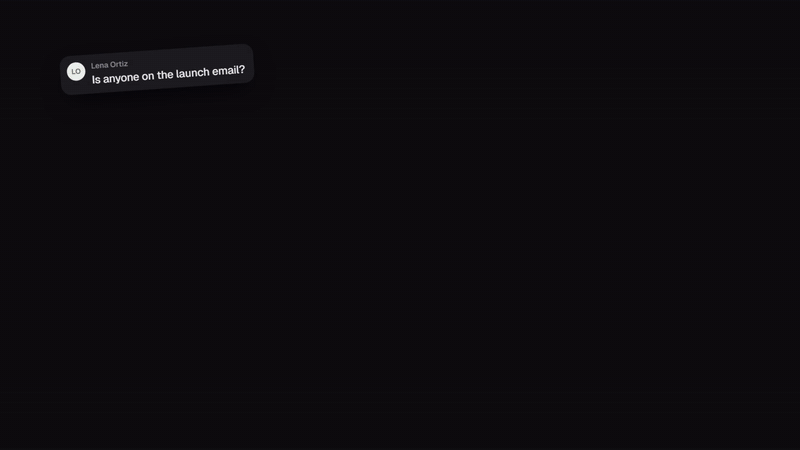
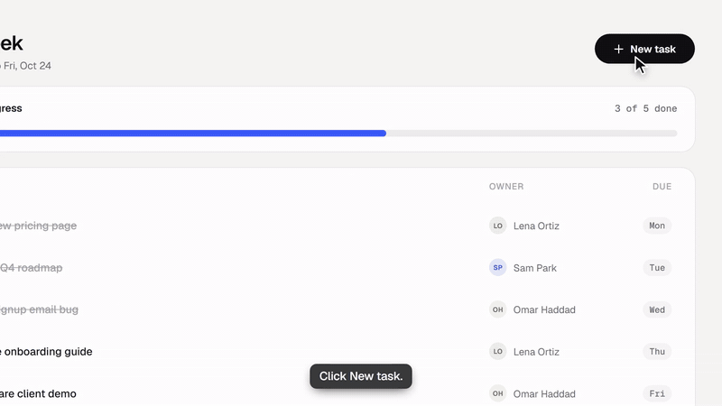
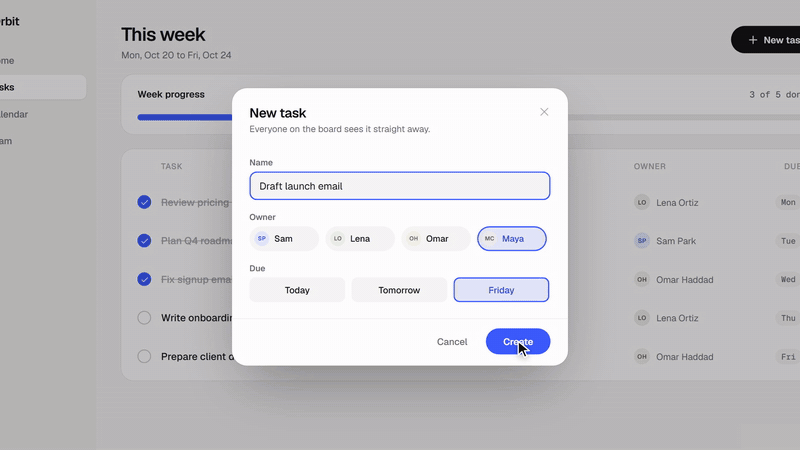
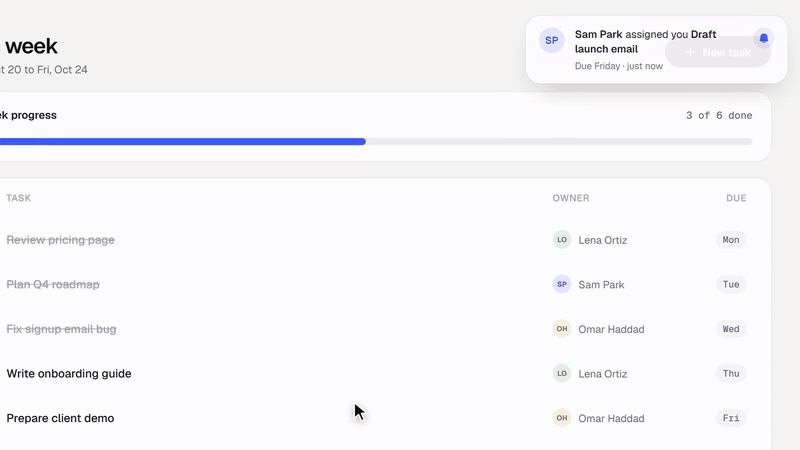
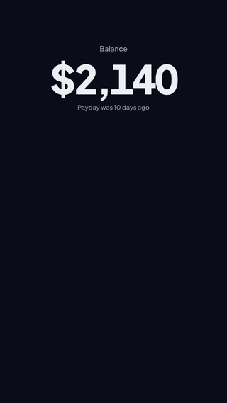
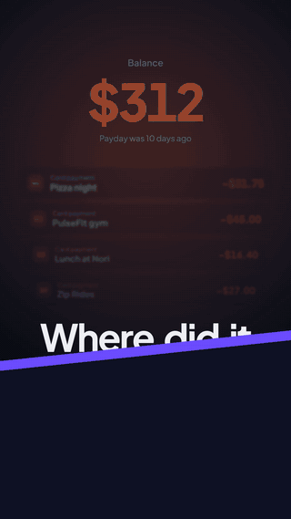
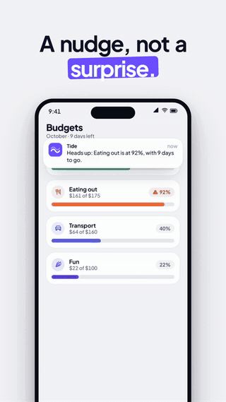

# Feature Explainer Video

An agent skill that turns **your own app** into a narrated video: a step-by-step **feature walkthrough**, or a punchy **product ad** for Reels, Shorts and TikTok.

It reads your code to understand the product and writes a script for you to approve. Every script opens with a hook. It records a free voiceover on your machine and rebuilds your real screens in your own colors and fonts. Then it animates everything with camera moves, a cursor or a phone, kinetic headlines, subtitles, sound effects and a generated music bed. Every label in the video comes from your code, so the video never shows something the product doesn't do.

Built on [Remotion](https://www.remotion.dev) and [Kokoro TTS](https://huggingface.co/hexgrad/Kokoro-82M). No API keys, no paid voice service, no music licence.

### It opens with a hook



*The first 8 seconds of a walkthrough the skill made for **Orbit Tasks**, a made-up task app: the problem first, then the product.*

### Feature walkthrough (16:9)

| Fill in a new task | It lands, and the owner is told | Tick it off, progress moves |
|---|---|---|
|  |  |  |

*The rest of the 41 second Orbit Tasks video. Full project: [examples/orbit-demo](examples/orbit-demo).*

### Product ad (9:16)

| The hook | Every account | The nudge | More features |
|---|---|---|---|
|  |  |  |  |

*A 31 second ad for **Tide**, a made-up money app. Full project: [examples/tide-ad](examples/tide-ad).*

## Install

### With the skills CLI (works with Claude Code, Cursor, Codex and more)

| What | pnpm | npm |
|---|---|---|
| Install for this project | `pnpm dlx skills add arham777/feature-explainer-video` | `npx skills add arham777/feature-explainer-video` |
| Install for every project | `pnpm dlx skills add arham777/feature-explainer-video -g` | `npx skills add arham777/feature-explainer-video -g` |
| Only for Claude Code | `pnpm dlx skills add arham777/feature-explainer-video -a claude-code` | `npx skills add arham777/feature-explainer-video -a claude-code` |
| Get the latest version | `pnpm dlx skills update feature-explainer-video` | `npx skills update feature-explainer-video` |
| See what is installed | `pnpm dlx skills list` | `npx skills list` |
| Remove it | `pnpm dlx skills remove feature-explainer-video` | `npx skills remove feature-explainer-video` |

The skill is copied onto your machine when you install it. Updates don't arrive by themselves, so run `update` to get a new version.

### As a Claude Code plugin

Inside Claude Code:

```
/plugin marketplace add arham777/feature-explainer-video
/plugin install feature-explainer-video@arham777-skills
```

### By hand

Copy `skills/feature-explainer-video/` into `~/.claude/skills/` for every project, or into `.claude/skills/` for one project.

### It also needs

- The **`remotion-best-practices`** skill. This skill loads it before writing any Remotion code:
  `pnpm dlx skills add remotion-dev/skills` (or `npx skills add remotion-dev/skills`)
- Node 18 or newer.
- About 90 MB of disk for the voice model, downloaded on the first run.

## Use it

Open your app's repo in your agent and ask for a video. For example:

> Make an explainer video of how invoices get approved, for staff and managers.

> Make a walkthrough video of a support ticket: opened, assigned, sent back for details, then solved.

> Make a 30 second vertical ad for our app for Reels and TikTok. Open on the problem it solves.

> I need a 90 second demo video of the invoice screen for our sales team. Captions only, no voice.

The skill first tells you what the product does for each role and shows a draft script as a table, starting with the hook. It only starts building after you say yes. More prompts and both full scripts are in [examples/](examples/README.md).

## How it works

| Step | What happens |
|---|---|
| 1. Understand | Maps the feature or product from the code: pages, dialogs, statuses, roles, limits, notifications, error messages, design tokens, and the problem each feature solves. |
| 2. Script | Shows a script table (time, what is on screen, what is said) that opens with a hook, and asks a few questions: walkthrough or ad, voice or captions, aspect ratio, music, names. |
| 3. Set up | Creates a separate `video/` folder with its own lockfile, so it never touches your app's install. |
| 4. Sound | Records every line locally with Kokoro, downloads the sound effects and synthesises a music bed. Each scene stretches to fit its line, so audio and picture always stay in sync. |
| 5. Screens | Rebuilds each screen as a simple component in your own colors, fonts and copy, on a desktop stage or inside a phone. Labels and maths are imported from your code, not retyped. |
| 6. Motion | The hook builds and slams, wipes cut between moods, the cursor clicks, dialogs open, numbers count, the camera pushes in and headlines land, all timed to the words being spoken. |
| 7. Check and render | Renders single frames to check alignment, fixes what is off, then renders the MP4. |

The full guide, covering the hook, timing, animation, camera, cursor, headlines, wipes, voice, subtitles, sound effects, music and visuals, is in **[docs/how-it-works.md](docs/how-it-works.md)**.

## What is in this repo

```
skills/feature-explainer-video/
  SKILL.md                     the instructions the agent follows
  templates/                   plumbing copied into every new video project
    package.json               Remotion, kokoro-js, scripts (studio, voiceover, sfx, audio, stills, render)
    remotion.webpack.ts        alias to your app's shared code, so labels stay true
    scripts/generate-voiceover.ts   lines.ts to WAV files and durations.json
    scripts/fetch-sfx.ts            downloads six sound effects into public/sfx
    scripts/generate-audio.ts       synthesises the music bed, impact, pop and riser
    scripts/render-stills.ts        renders chosen frames for checking
    src/theme.ts               your design tokens, the video size and the stage size
    src/fonts.ts               loads your app's own font files before frame one
    src/timeline.ts            beats and chapters sized from the voice, hook lead-in, spokenAt()
    src/lib/motion.ts          easing curve, tween, spring pop, typing effect
    src/ui/Stage.tsx           scales a desktop app to 1080p and runs the camera
    src/ui/Cursor.tsx          the pointer: glide, click squash, ripple
    src/ui/Phone.tsx           a phone frame for mobile screens: rise, tilt
    src/ui/Headline.tsx        kinetic headline with a highlighter sweep
    src/ui/Wipe.tsx            the tilted band that covers a cut
    src/ui/Music.tsx           the music bed: fade in, sit under the voice, swell, fade out
    src/ui/Narration.tsx       voice clips and timed subtitles
    src/ui/Sfx.tsx             every sound effect, at volumes that sit under the voice
    src/voiceover/lines.ts     the script (one place for audio and subtitles)
docs/how-it-works.md           the deep dive
examples/README.md             prompts and both full scripts
examples/orbit-demo/           the feature walkthrough above
examples/tide-ad/              the product ad above
```

## Licenses

- This skill: [MIT](LICENSE).
- **Remotion** has its own license. It is free for individuals and for companies of up to 3 people. Bigger companies need a [company license](https://www.remotion.dev/license) to render videos with it.
- **Kokoro-82M** is Apache 2.0.
- Sound effects are downloaded from `remotion.media` by `pnpm sfx` when a project is set up. They are not stored in this repo. The music and the other sounds are generated by code in this repo.
- Orbit Tasks, Tide, their logos and their people are made up. The examples use the Geist and Plus Jakarta Sans fonts from Google Fonts.
